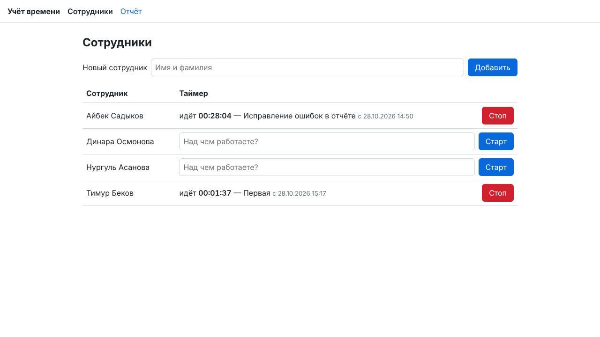

# Учёт рабочего времени

[](https://github.com/subanovkanat321/timetracker/actions/workflows/ci.yml)

Небольшое веб-приложение: сотрудники запускают и останавливают таймер с описанием задачи,
руководитель смотрит записи и общее время каждого сотрудника за выбранный период. Данные
хранятся в PostgreSQL и переживают перезапуск. Все данные в проекте вымышленные.

**Стек:** Java 21, Spring Boot 4.1.1 (Spring MVC, Thymeleaf, Data JPA, JDBC), PostgreSQL 17,
Flyway. Для тестов — JUnit 5, MockMvc, Testcontainers.



## Запуск

Нужен Docker.

```bash
docker compose up --build
```

Откройте http://localhost:8080 (порт открыт только для этой машины). При первом запуске создаются три вымышленных сотрудника,
несколько записей за прошлые дни и один идущий таймер.

Если порт 8080 занят:

```bash
APP_PORT=8081 docker compose up --build
```

**Без Docker** нужны Java 21 и свой PostgreSQL. Адрес базы задаётся переменными `DB_URL`,
`DB_USER`, `DB_PASSWORD`; по умолчанию это `localhost:5432/timetracker`, пользователь и пароль
`timetracker`.

```bash
./mvnw spring-boot:run
```

## Как проверить за 2 минуты

1. **Сотрудники.** Добавьте сотрудника. Добавьте его ещё раз, другими буквами:
   «айбек САДЫКОВ». Появится сообщение «уже есть».
2. **Таймер.** Введите задачу и нажмите «Старт»: счётчик тикает. Откройте вторую вкладку и
   нажмите «Старт» у того же сотрудника. Появится сообщение «У сотрудника уже идёт таймер:
   «…» с …». Нажмите «Стоп».
3. **Отчёт.** Откройте «Отчёт». По умолчанию это текущая неделя: итог по каждому сотруднику,
   в том числе нулевой, и список записей. Выберите период без записей: «За этот период
   записей нет», итог 0.
4. **Перезапуск.** Выполните `docker compose down` (без `-v`), затем `docker compose up`.
   Данные на месте, идущий таймер продолжает идти. То же самое проверяет CI.

## Решения и почему так

- **Повторный запуск таймера запрещает база, а не код.** Частичный уникальный индекс
  `time_entry (employee_id) where ended_at is null` не даёт сотруднику иметь два идущих
  таймера. Старт делается одной командой
  `INSERT … ON CONFLICT (employee_id) WHERE ended_at IS NULL DO NOTHING RETURNING id`: если
  таймер уже идёт, вставка ничего не делает, и приложение отвечает понятным сообщением.
  - Если два «Старта» придут одновременно, второй дождётся первого и получит отказ.
  - Проверка «есть ли идущий таймер» в коде перед вставкой здесь не помогла бы: оба запроса
    успели бы её пройти.
- **Отчёт считает только время внутри периода.** Запись с 23:00 воскресенья до 01:00
  понедельника даёт понедельнику 1 час. Идущий таймер считается до текущего момента.
  - Расчёт — чистая функция `Overlap.of`, у неё табличный unit-тест.
  - Период — с 2000 по 2100 год и не длиннее года.
- **Время в базе хранится в UTC, а дни и часы показываются по Бишкеку (UTC+6).** Отчёт
  «за 27 октября» — это 27 октября по местному времени.
- **Длительность показывается с секундами** («5 ч 35 мин 05 с»). Иначе строки отчёта не
  сходились бы с итогом: три записи по 40 секунд — это 2 минуты, а не ноль.
- **Каждое действие заканчивается редиректом** (Post/Redirect/Get). Обновление страницы не
  повторит действие, а результат показывается одноразовым сообщением.
- **«Сейчас» берётся только из бина `Clock`.** В тестах часы подменяются, и время становится
  предсказуемым.

Устройство кода: пакеты по фичам `employee`, `timer`, `report`, `web`. Схему базы создаёт
Flyway (`src/main/resources/db/migration`).

## Тесты

```bash
./mvnw verify
```

Нужен Docker: тесты поднимают настоящий PostgreSQL через Testcontainers. Всего 70 тестов, они
же идут в CI на каждый PR.

| Тесты | Что проверяют |
|---|---|
| `TimerServiceTests` | старт и стоп; **повторный запуск** отклонён, идущий таймер один; гонка двух стартов; стоп без таймера; неизвестный сотрудник; пустое и длинное описание |
| `ReportServiceTests` | **пустой отчёт** (нет сотрудников; нет записей — нули у всех); суммы; обрезка по границе периода; сутки по Бишкеку; идущий таймер; запись нулевой длины; строки сходятся с итогом; неделя по умолчанию |
| `OverlapTests` | расчёт пересечения записи с периодом: 12 случаев таблицей |
| `FormatsTests` | длительность с секундами (доли секунды отбрасываются), дата и время по Бишкеку |
| `TextsTests` | обрезка длинного ввода не разрывает эмодзи пополам |
| `EmployeeServiceTests` | добавление, пустое и длинное имя, недопустимые символы, дубликат без учёта регистра (кириллица) |
| `WebTests` | страницы целиком через MockMvc: сообщения, стоп, строки отчёта, пустой отчёт, неверные и крайние даты |
| `DemoDataTests` | демо-данные создаются один раз и не дублируются |
| `ErrorPageTests` | русская страница ошибки на настоящем сервере |
| `RestartTests` | данные и идущий таймер видны после перезапуска приложения |

Гонку тест создаёт сам, на удачу планировщика не полагается:
1. Тест вставляет идущий таймер в открытой транзакции и не коммитит её.
2. Второй «Старт» в другом потоке встаёт в ожидание блокировки (это видно в
   `pg_stat_activity`).
3. Тест коммитит транзакцию, и второй старт получает отказ.

## Как использовался ИИ

**Инструменты:** [Claude Code](https://claude.com/claude-code) — агент для разработки от
Anthropic на моделях семейства Claude. С ним использовался набор команд
[gstack](https://github.com/garrytan/gstack):

| Команда | Что делает |
|---|---|
| `/office-hours` | Разбор задачи и дизайн-док |
| `/plan-eng-review` | Ревью архитектуры и плана тестов |
| `/review` | Ревью диффа |
| `/qa` | Проверка в браузере |
| `/ship` | PR |

Дизайн и план дополнительно проверял отдельный агент-ревьюер, который не видел переписку.

**Как распределялась работа.** Код писал ИИ. Решения принимались через вопросы с вариантами,
например:
- держать ли защиту от повторного старта в базе или в коде;
- как показывать длительность;
- как проверять гонку.

Каждый результат проверялся тестами и ручным запуском.

**Примеры запросов** (дословно):

- `/office-hours` + полный текст задания. Результат: дизайн-док с допущениями, тремя
  вариантами реализации и планом тестов.
- `https://github.com/subanovkanat321/timetracker.git продолжай`. Результат: каркас приложения
  по дизайн-доку.
- `учти еще команды gstack запускай его команды все по порядку`. Результат: перед тестами
  прошло ревью архитектуры, и после него код упростился (см. ошибку 5).

**Какие ошибки ИИ были найдены и исправлены.** Подробно, с тем, как каждая найдена, — в
[AI_LOG.md](AI_LOG.md). Главные:

1. **Чтение в «сломанной» транзакции.** ИИ предлагал после ошибки уникального индекса читать
   идущий таймер в той же транзакции. Postgres её к этому моменту уже прервал. Нашло ревью
   дизайна. Итог — `ON CONFLICT DO NOTHING`, при нём транзакция не ломается.
2. **Тесты внутри `docker build`.** Там нет Docker для Testcontainers, сборка упала бы у
   проверяющего. Итог: `-DskipTests` в `Dockerfile`, тесты гоняются в CI.
3. **Отчёт расходился сам с собой.** Строки без секунд, а итог с точными секундами. Итог:
   секунды показываются везде.
4. **Короткие записи пропадали из отчёта.** Фильтр «нулевая длительность» прятал записи, где
   «Старт» и «Стоп» нажаты в одну секунду.
5. **Слишком сложная защита от повторного старта.** Был отдельный класс, разбор цепочки
   исключений Hibernate и вторая транзакция. Заменено одной SQL-командой.
6. **`;jsessionid=` в адресе** после первого действия. Нашлось при ручном запуске.
7. **Тест перезапуска подключался к чужой базе.** Свойства `SpringApplicationBuilder`
   перекрывались `application.yaml`.
8. **Тест страницы ошибки на MockMvc** не мог пройти в принципе: MockMvc не перенаправляет
   запрос на `/error`.
9. **Ввод, который приводил к 500.** Нашло ревью перед слиянием (`/review`): символ `\0` в
   имени, крайние даты отчёта (`+999999999-12-31`), доли секунды, из-за которых строки отчёта
   не сходились с итогом. Каждая ошибка сначала воспроизведена на запущенном приложении или
   падающим тестом, потом исправлена.
10. **Устойчивость к злонамеренному вводу.** Финальное ревью (`/ship`) нашло: огромный ввод
    оседал в памяти через сессию, невидимые символы за пределами U+FFFF и неразрывные пробелы
    проходили проверку имени, стоп после перевода часов назад давал 500. Ещё одну ошибку ИИ нашёл
    сам, перечитывая свой дифф: обрезка ввода разрывала эмодзи пополам.
11. **Вёрстка на телефоне и 404 в консоли.** Нашла проверка в браузере (`/qa`): на экране 375 px
    страницы были шире экрана, а браузер запрашивал несуществующую иконку.

## Что можно доработать

- Редактирование и удаление записей (сейчас записи только создаются таймером).
- Фильтр отчёта по одному сотруднику и экспорт в CSV.
- Авторизация: сотрудник управляет только своим таймером, руководитель видит всех.
- Для большой истории — индекс по `ended_at` или по диапазону `tstzrange`, чтобы отчёт не
  сканировал старые записи.
